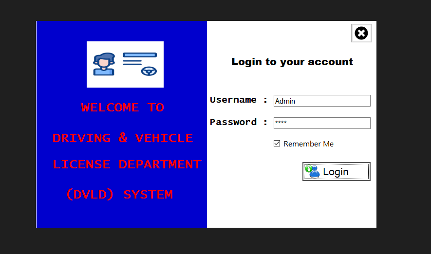
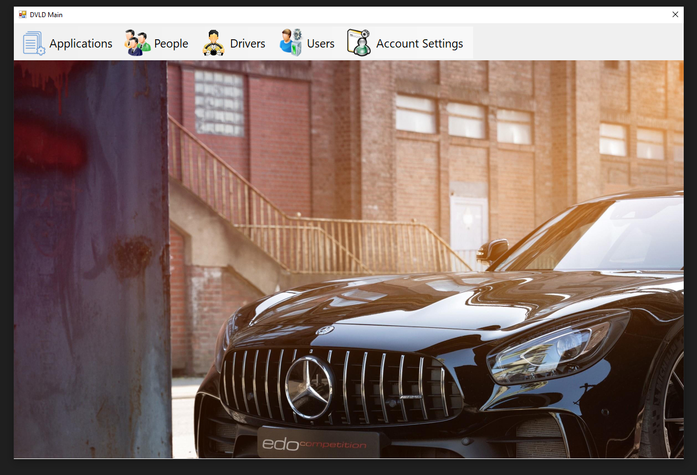

# Driving & Vehicle Licensing Department System (DVLD)

A desktop application built to manage driving license services and streamline the licensing process.

## 📌 Project Overview

The Driving & Vehicle Licensing Department System (DVLD) manages various driving license services, including issuing new licenses, renewing licenses, replacing lost or damaged licenses, and managing detained licenses.

The system also manages the required tests for first-time license applicants.

## ✨ Features

### License Services
- First-time driving license issuance.
- License renewal.
- Replacement of lost or damaged licenses.
- License detention and release.
- International driving license issuance.

### Test Management
- Vision Test.
- Written Test.
- Street Test.
- Test appointment scheduling.
- Test retakes management.

### Applicant Management
- Manage people and applicants.
- Track license applications and their statuses.
- Validate application requirements.

## 🏗️ Architecture

The project follows the **3-Tier Architecture** to separate responsibilities into three layers:

- **Presentation Layer:** Handles the user interface and user interactions.
- **Business Logic Layer:** Contains business rules, validations, and application logic.
- **Data Access Layer:** Handles database operations and communication with SQL Server.

## 🛠️ Technologies Used

- C#
- Windows Forms
- ADO.NET
- SQL Server
- 3-Tier Architecture
- Object-Oriented Programming (OOP)

## 🗄️ Database

A database backup is included in the `Database` folder.

To use the application:

1. Download or clone the repository.
2. Restore the `DVLD.bak` file using SQL Server Management Studio (SSMS).
3. Configure the connection string in `App.config` to match your SQL Server instance.
4. Open the solution file in Visual Studio.
5. Build and run the application.

## 🎯 Project Purpose

This project was developed as an academic/training project to apply programming fundamentals, Object-Oriented Programming, database operations, and 3-Tier Architecture in a practical business application.

## 👩‍💻 Developer

**Mariam Yousry**

[GitHub](https://github.com/MariamYousry1234)

## 📸 Screenshots

